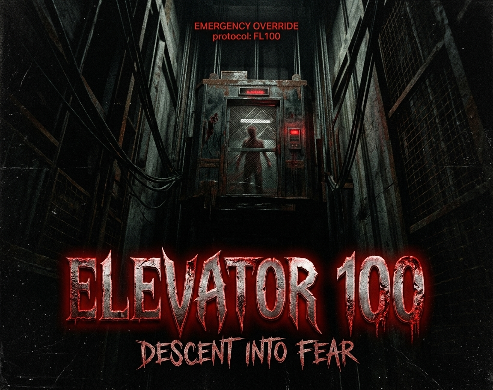
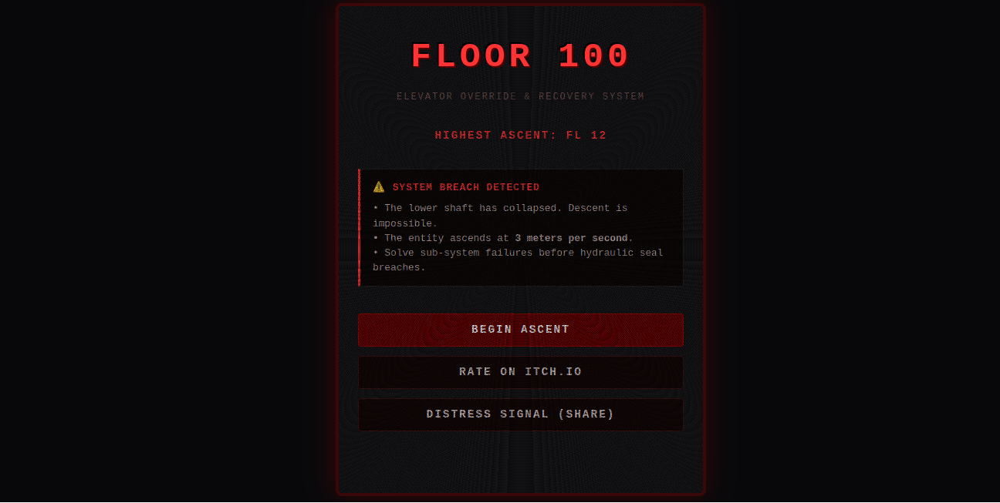
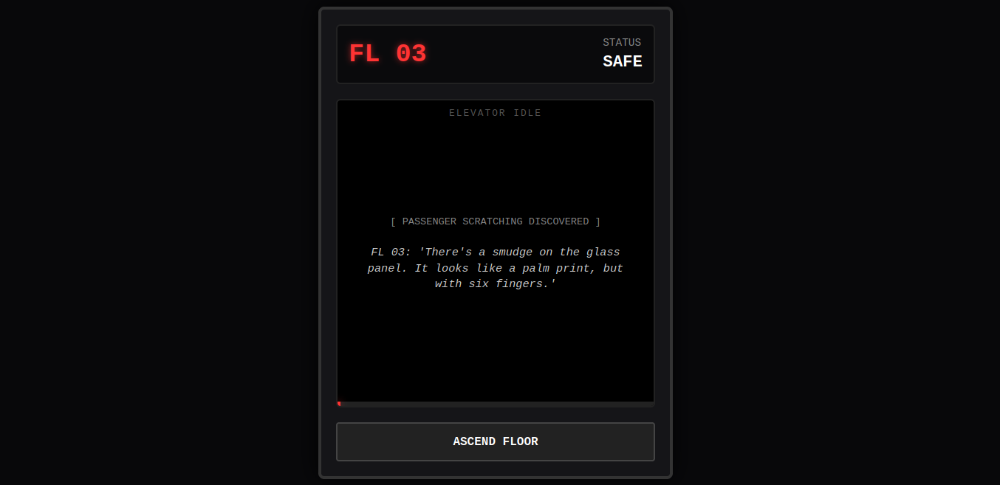
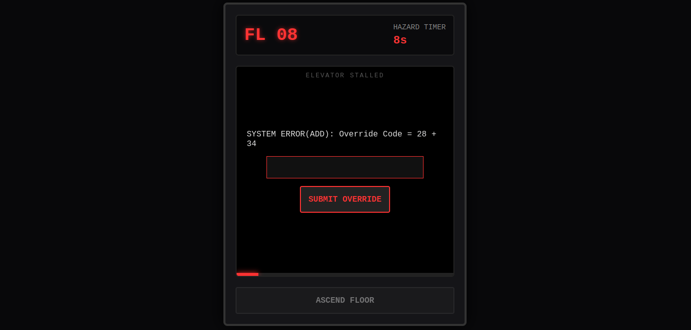

<div align="center">



# 🚪 ELEVATOR 100: Descent into Fear

> **Emergency Override Protocol Active.** The lower shaft has collapsed. The entity ascends at 3 meters per second. Ascend 100 floors before hydraulic seal failure.

[](https://vimal9ram-nap.itch.io/elevator-100)
[](https://vimal9ram-nap.github.io/elevator-100/)
[](LICENSE)

---

### 🕹️ Play Directly in Browser

[](https://vimal9ram-nap.itch.io/elevator-100)

</div>

---

## 📖 Overview

**Elevator 100** is a lightweight, atmospheric HTML5 horror survival game built entirely with native web technologies. Designed for zero-dependency execution, minimal memory overhead, and immersive retro CRT tension.

---

## 📸 Screenshots & Showcase

|       Start Interface & High Score       |           Terminal Passenger Logs            |
| :--------------------------------------: | :------------------------------------------: |
|  |  |

|       System Error Override Hazard        |           Entity Visual Jumpscare            |
| :---------------------------------------: | :------------------------------------------: |
|  |  |

---

## 🕹️ Key Features

- **Procedural Sub-System Hazards:** Dynamic text-based code overrides on stalled hazard floors under a strict countdown timer.
- **Pure Web Audio Synthesizer:** Real-time procedural audio synthesis generated on-the-fly with native Web Audio API oscillators — zero external sound files downloaded.
- **Passenger Lore Terminal:** Uncover terminal notes and eerie logs left behind by previous elevator victims as you ascend.
- **Distress Signal Link Sharing:** Built-in dynamic URL parameters allow players to share custom progress and distress links with friends.
- **Local Ascent Tracking:** High scores and deepest floor records are tracked automatically using browser `localStorage`.

---

## 🛠️ Tech Stack

- **HTML5 & CSS3:** Custom CRT scanline effects, glowing ambient drop-shadows, and responsive layout.
- **JavaScript (ES6+):** Async game logic state management and mathematical puzzle generators.
- **Web Audio API:** Custom oscillator graphs generating real-time low-frequency ambient hums, alarms, and jumpscare soundscapes.

---

## 🚀 How to Run Locally

Because the game uses native web technology, no build steps, node modules, or external servers are required.

1. **Clone the repository:**
   ```bash
   git clone [https://github.com/Vimal9RAM-NAP/elevator-100.git](https://github.com/Vimal9RAM-NAP/elevator-100.git)
   ```
2. Navigate into the directory:

   ```bash
   cd elevator-100
   ```

3. Open index.html in any web browser.

## 📄 License

Distributed under the MIT License. See LICENSE for more information.
